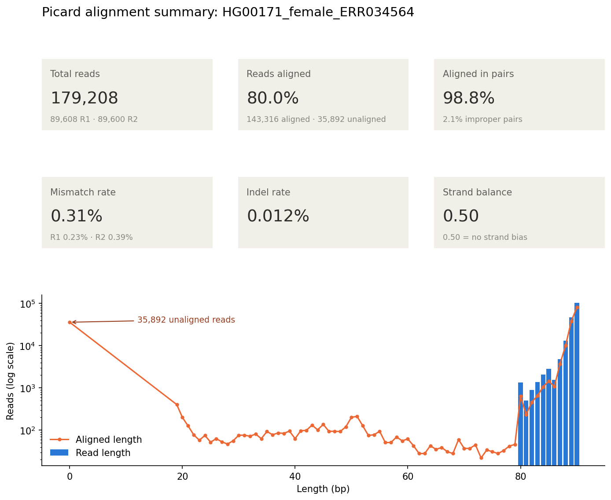

#  From FASTQ to BAM Tutorial for short-read paired-end NGS Illumina data

In this tutorial you will learn how to analyze NGS data step by step.
To exemplify this we will use 2xCoriell data, sequenced using WES. 
For practicality this dataset was cut to contain only few genes, emulated a Panel Sequencing dataset.

In this tutorial, you will learn how to **analyze NGS (Next-Generation Sequencing)** data step by step.

To illustrate the process, we will use **2×Coriell** data, HG00171 and HG00152, sequenced using **Whole Exome Sequencing (WES)**, freely downlable from [https://www.internationalgenome.org/data-portal/sample](https://www.internationalgenome.org/data-portal/sample).

For practicality, this dataset was trimmed to include only a few genes, effectively **emulating a Panel Sequencing dataset**. You can download these trimmed raw fastq raw from [zenodo](https://zenodo.org/records/17598455) and place them under `workshop-ngs-bioinfo/data/raw_fastq`. 

## Table of Contents

- [1. Installation and Data Download](#1-installation-and-data-download)
  - [1.1 Clone the Repository](#11-clone-the-repository)
  - [1.2 Install Required Tools](#12-install-required-tools)
  - [1.3 Download Input Data and Reference Genome](#13-download-input-data-and-reference-genome)

- [2. Prepare Reference Genome](#2-prepare-reference-genome)

- [3. Run Quality Control Using FastQC and MultiQC on Raw FASTQ](#3-run-quality-control-using-fastqc-and-multiqc-on-raw-fastq)

- [4. Trimming with Trim Galore!](#4-trimming-with-trim-galore)

- [5. Run MultiQC on Trimmed FASTQ](#5-run-multiqc-on-trimmed-fastq)

- [6. Create Mapping Index Required by BWA](#6-create-mapping-index-required-by-bwa)

- [7. Perform Alignment Using BWA and Sort](#7-perform-alignment-using-bwa-and-sort)

- [8. Deduplication and Quality Control](#8-deduplication-and-quality-control)
  - [8.1 Mark and Remove Duplicates with Picard](#81-mark-and-remove-duplicates-with-picard)
  - [8.2 Keep Only Properly Paired Reads](#82-keep-only-properly-paired-reads)
  - [8.3 Run Final QC on Cleaned BAM Files](#83-run-final-qc-on-cleaned-bam-files)

- [9. Compute Coverage Track](#9-compute-coverage-track)

---


## 1. Installation and Data Download

### 1.1 Clone the Repository

```
git clone https://github.com/madagiurgiu25/workshop-ngs-bioinfo.git
cd workshop-ngs-bioinfo
```

From now on the working directory will be the `workshop-ngs-bioinfo`.

### 1.2 Install Required Tools

Use the installation guide from [tutorial_install.md](tutorial_install.md) and activate enviroment:

```
conda activate bioinfo2025
```

### 1.3 Download Input Data and Reference Genome

Download the input data in FASTQ format and the GRCh38/hg38 GENCODE human reference genome by following the steps in [tutorial_install.md](tutorial_install.md). Make sure your data structure is organized like:

```
workshop-ngs-bioinfo
    ├── data
        ├── index
        │   ├── GRCh38.primary_assembly.genome.fa
        ├── raw_fastq
            ├── HG00152_male_SRR769545_1.cut.fastq.gz
            ├── HG00152_male_SRR769545_2.cut.fastq.gz
            ├── HG00171_female_ERR034564_1.cut.fastq.gz
            └── HG00171_female_ERR034564_2.cut.fastq.gz
```

## 2. Prepare Reference Genome

For this workshop, we will focus on **chr5, chr7, chr13, chr17, and chrX**, covering the following genes: ARX, SMN2, SMN1, PSM2, BRCA2, BRCA1, DMD.
Working with a reduced reference genome will save both time and disk space.

Use `samtools` to extract only these chromosomes:

```bash
# Create index for the reference genome (useful for quick access to sequence for e.g. IGV, GATK, samtools)
cd workshop-ngs-bioinfo/data/index
samtools faidx GRCh38.primary_assembly.genome.fa

# Select chromosomes of interest
samtools faidx GRCh38.primary_assembly.genome.fa chr5 chr7 chr13 chr17 chrX > GRCh38.primary_assembly.genome.cut.fa

# Index the reduced reference
samtools faidx GRCh38.primary_assembly.genome.cut.fa
```

After this step, you should have the following files:

```
└── workshop-ngs-bioinfo
    ├── data
        ├── index
            ├── GRCh38.primary_assembly.genome.fa
            ├── GRCh38.primary_assembly.genome.fa.fai
            ├── GRCh38.primary_assembly.genome.cut.fa
            ├── GRCh38.primary_assembly.genome.cut.fa.fai  
```


## 3. Run Quality Control Using FastQC and MultiQC on Raw FASTQ

In this step, you will check the quality of your raw FASTQ data.

```bash
cd workshop-ngs-bioinfo/data
mkdir -p fastqc_reports

# Run FastQC
fastqc -t 4 -o fastqc_reports raw_fastq/*.fastq.gz

# Summarize all reports with MultiQC
multiqc fastqc_reports -o multiqc_report
```

After this step, you should have the following reports:

```
└── workshop-ngs-bioinfo
    ├── data
        ├── fastqc_reports
            ├── HG00152_male_SRR769545_1.cut_fastqc.html
            ├── HG00152_male_SRR769545_1.cut_fastqc.zip
            ├── HG00152_male_SRR769545_2.cut_fastqc.html
            ├── HG00152_male_SRR769545_2.cut_fastqc.zip
            ├── HG00171_female_ERR034564_1.cut_fastqc.html
            ├── HG00171_female_ERR034564_1.cut_fastqc.zip
            ├── HG00171_female_ERR034564_2.cut_fastqc.html
            └── HG00171_female_ERR034564_2.cut_fastqc.zip
        ├── multiqc_report
            ├── multiqc_data
            ...
            └── multiqc_report.html

```

## 4. Trimming with Trim Galore!

The datasets **HG00152** and **HG00171** do not require adapter or hard trimming.
However, it is good practice to perform **soft trimming** to remove low-quality bases (below Q20) and to discard reads shorter than 50 bp.
This also accounts for ambiguous bases (Ns), which typically correspond to low-quality regions. You can specify using `--fastqc` to run automatically FastQC for the trimmed reads.

Run on your dataset:

```bash
#cd workshop-ngs-bioinfo/data
mkdir -p trimmed_fastq

# Trim HG00171
trim_galore -q 20 --phred33 --illumina --paired -j 1 --length 50 --fastqc -o trimmed_fastq \
raw_fastq/HG00171_female_ERR034564_1.cut.fastq.gz \
raw_fastq/HG00171_female_ERR034564_2.cut.fastq.gz

# Trim HG00152
trim_galore -q 20 --phred33 --illumina --paired -j 1 --length 50 --fastqc -o trimmed_fastq \
raw_fastq/HG00152_male_SRR769545_1.cut.fastq.gz \
raw_fastq/HG00152_male_SRR769545_2.cut.fastq.gz
```

After this step you should have the following files:

```bash
└── workshop-ngs-bioinfo
    ├── data
        └── trimmed_fastq
            ├── HG00152_male_SRR769545_1.cut.fastq.gz_trimming_report.txt
            ├── HG00152_male_SRR769545_1.cut_val_1.fq.gz
            ├── HG00152_male_SRR769545_1.cut_val_1_fastqc.html
            ├── HG00152_male_SRR769545_1.cut_val_1_fastqc.zip
            ├── HG00152_male_SRR769545_2.cut.fastq.gz_trimming_report.txt
            ├── HG00152_male_SRR769545_2.cut_val_2.fq.gz
            ├── HG00152_male_SRR769545_2.cut_val_2_fastqc.html
            ├── HG00152_male_SRR769545_2.cut_val_2_fastqc.zip
            ├── HG00171_female_ERR034564_1.cut.fastq.gz_trimming_report.txt
            ├── HG00171_female_ERR034564_1.cut_val_1.fq.gz
            ├── HG00171_female_ERR034564_1.cut_val_1_fastqc.html
            ├── HG00171_female_ERR034564_1.cut_val_1_fastqc.zip
            ├── HG00171_female_ERR034564_2.cut.fastq.gz_trimming_report.txt
            ├── HG00171_female_ERR034564_2.cut_val_2.fq.gz
            ├── HG00171_female_ERR034564_2.cut_val_2_fastqc.html
            └── HG00171_female_ERR034564_2.cut_val_2_fastqc.zip
```

## 5. Run MultiQC on Trimmed FASTQ

We rerun FastQC in combination with MultiQC for completeness.

```bash
#cd workshop-ngs-bioinfo/data
mkdir -p fastqc_reports_trimmed
fastqc -t 4 -o fastqc_reports_trimmed trimmed_fastq/*.fq.gz
multiqc fastqc_reports_trimmed -o multiqc_report_trimmed
```

Note that the QC file `data/trimmed_fastq/HG00152_male_SRR769545_1.cut_val_1_fastqc.html` generated on the fly while running `trim_galore` should contain same information as the `data/fastqc_reports_trimmed/HG00152_male_SRR769545_1.cut_val_1_fastqc.html` (similar for the other trimmed files).

```bash
└── workshop-ngs-bioinfo
    ├── data
        ├── multiqc_report_trimmed
            ├── multiqc_data
                ...
            └── multiqc_report.html
    ├── fastqc_reports_trimmed
            ├── HG00152_male_SRR769545_1.cut_val_1_fastqc.html
            ├── HG00152_male_SRR769545_1.cut_val_1_fastqc.zip
            ├── HG00152_male_SRR769545_2.cut_val_2_fastqc.html
            ├── HG00152_male_SRR769545_2.cut_val_2_fastqc.zip
            ├── HG00171_female_ERR034564_1.cut_val_1_fastqc.html
            ├── HG00171_female_ERR034564_1.cut_val_1_fastqc.zip
            ├── HG00171_female_ERR034564_2.cut_val_2_fastqc.html
            └── HG00171_female_ERR034564_2.cut_val_2_fastqc.zip
```


## 6. Create Mapping Index Required by BWA

In this step, we will create a **BWA mapping index** for the reference genome.
This process generates the required `.bwt`, `.pac`, `.ann`, `.amb`, and `.sa` files used during alignment.

```bash
# Create mapping index (this may take a while)
#cd workshop-ngs-bioinfo/data
bwa index index/GRCh38.primary_assembly.genome.cut.fa
```

Output:

```bash
└── workshop-ngs-bioinfo
    ├── data
        ├── index
            ├── GRCh38.primary_assembly.genome.cut.fa
            ├── GRCh38.primary_assembly.genome.cut.fa.amb
            ├── GRCh38.primary_assembly.genome.cut.fa.ann
            ├── GRCh38.primary_assembly.genome.cut.fa.bwt
            ├── GRCh38.primary_assembly.genome.cut.fa.fai
            ├── GRCh38.primary_assembly.genome.cut.fa.pac
            ├── GRCh38.primary_assembly.genome.cut.fa.sa
```


## 7. Perform Alignment Using BWA and Sort

We align next the reads to the reference genome using `bwa`. After this step a `BAM` file is generated. This requires afterwards sorting and indexing. 

Example for **HG00171**:

```bash
cd workshop-ngs-bioinfo/data
mkdir -p mapping

# Setup input
sample=HG00171_female_ERR034564
fastq1=trimmed_fastq/${sample}_1.cut_val_1.fq.gz
fastq2=trimmed_fastq/${sample}_2.cut_val_2.fq.gz
ref=index/GRCh38.primary_assembly.genome.cut.fa

# Alignment with read group information
bwa mem -R "@RG\tID:${sample}\tSM:${sample}\tPL:ILLUMINA\tLB:lib1\tPU:unit1" ${ref} ${fastq1} ${fastq2} | samtools view -bS - > mapping/${sample}.bam

# Sort and index alignment
samtools sort -o mapping/${sample}.sorted.bam mapping/${sample}.bam
samtools index mapping/${sample}.sorted.bam
```

Repeat this step for `HG00152_male_SRR769545` sample. As result you should have following files:

```
└── workshop-ngs-bioinfo
    ├── data
    ├── mapping
        ├── HG00152_male_SRR769545.bam
        ├── HG00152_male_SRR769545.sorted.bam
        ├── HG00152_male_SRR769545.sorted.bam.bai
        ├── HG00171_female_ERR034564.bam
        ├── HG00171_female_ERR034564.sorted.bam
        ├── HG00171_female_ERR034564.sorted.bam.bai
```

Repeat this step for `HG00152_male_SRR769545` sample.


## 8. Deduplication and Quality Control

We need deduplication in NGS data analysis to remove duplicate reads that arise not from biology, but from the sequencing process — mainly during PCR amplification in library preparation. Additionally, we want to keep only reads which are "properly-paired", i.e. remove unmapped, singletons or other reads. This will make the dataset more reliable for the downstream analysis, i.e. SNV and INDELs calling. 

**!IMPORTANT:** Please note that for SV calling keeping only "properly-paired" reads is not sufficient, as in this case you are interested keeping discordant and split-reads.

In this step we will:
- remove PCR duplicates using **Picard MarkDuplicates**
- keep only properly-paired reads
- sort and index 
- run quality checks on the cleaned BAM files

### 8.1 Mark and Remove Duplicates with Picard

```bash
# cd workshop-ngs-bioinfo/data
mkdir -p dedup

sample=HG00171_female_ERR034564

# Mark and remove duplicates
picard MarkDuplicates \
    I=mapping/${sample}.sorted.bam \
    O=dedup/${sample}.dedup.bam \
    M=dedup/${sample}.dedup.metrics.txt \
    REMOVE_DUPLICATES=true

# Index the deduplicated BAM
samtools index dedup/${sample}.dedup.bam
```

Your deduplicated files should look as following:

```bash
└── workshop-ngs-bioinfo
    ├── data
        ├── dedup
            ├── HG00152_male_SRR769545.dedup.bam
            ├── HG00152_male_SRR769545.dedup.bam.bai
            ├── HG00152_male_SRR769545.dedup.metrics.txt
            ├── HG00171_female_ERR034564.dedup.bam
            ├── HG00171_female_ERR034564.dedup.bam.bai
            ├── HG00171_female_ERR034564.dedup.metrics.txt
```

Assess alignment and duplication statistics with **Picard QC metrics**:

```bash
cd workshop-ngs-bioinfo/data
sample=HG00171_female_ERR034564

picard CollectAlignmentSummaryMetrics \
    R=index/GRCh38.primary_assembly.genome.cut.fa \
    I=dedup/${sample}.dedup.bam \
    O=dedup/${sample}.alignment_summary.txt

python ../picard_summary.py -o dedup/{sample}.alignment_summary.png dedup/${sample}.alignment_summary.txt
```



### 8.2 Keep Only Properly Paired Reads

Filter BAM such that only properly-paired reads are kept. To understand this step check the [SAM Flag encoding](https://broadinstitute.github.io/picard/explain-flags.html).

```bash
cd workshop-ngs-bioinfo/data
mkdir -p ppaired
sample=HG00171_female_ERR034564

# Remove reads which are not properly paired
# -f 2 = keep properly paired
samtools view -b -f 2 -F 4 -F 8 dedup/${sample}.dedup.bam > ppaired/${sample}.proper.bam

# Sort and index deduplicated BAM
samtools sort -o ppaired/${sample}.proper.sorted.bam ppaired/${sample}.proper.bam
samtools index ppaired/${sample}.proper.sorted.bam

```

Repeat steps above for `HG00152_male_SRR769545` sample.

After these step you should have:

```
workshop-ngs-bioinfo
├── data
    ├── ppaired
        ├── HG00152_male_SRR769545.proper.bam
        ├── HG00152_male_SRR769545.proper.sorted.bam
        ├── HG00152_male_SRR769545.proper.sorted.bam.bai
        ├── HG00171_female_ERR034564.proper.bam
        ├── HG00171_female_ERR034564.proper.sorted.bam
        └── HG00171_female_ERR034564.proper.sorted.bam.bai

```

### 8.3 Run Final QC on Cleaned BAM Files

Finally, run **FastQC** and **MultiQC** again on the cleand BAM (deduplicated+properly-paired). For this we need to convert the BAM to FASTQ:

```bash
cd workshop-ngs-bioinfo/data

sample=HG00171_female_ERR034564
samtools fastq ppaired/${sample}.proper.sorted.bam -1 ppaired/${sample}.proper_R1.fastq -2 ppaired/${sample}.proper_R2.fastq

sample=HG00152_male_SRR769545
samtools fastq ppaired/${sample}.proper.sorted.bam -1 ppaired/${sample}.proper_R1.fastq -2 ppaired/${sample}.proper_R2.fastq

mkdir -p fastqc_reports_clean
fastqc -t 4 -o fastqc_reports_clean ppaired/*.fastq
multiqc fastqc_reports_clean -o multiqc_report_clean
```

## 9. Compute Coverage Track

Create a BigWig coverage file for visualization in IGV:

```bash
#cd workshop-ngs-bioinfo/data
sample=HG00171_female_ERR034564
bamCoverage -b ppaired/${sample}.proper.sorted.bam -o mapping/${sample}.coverage.bw
```
Repeat steps above for `HG00152_male_SRR769545` sample.

